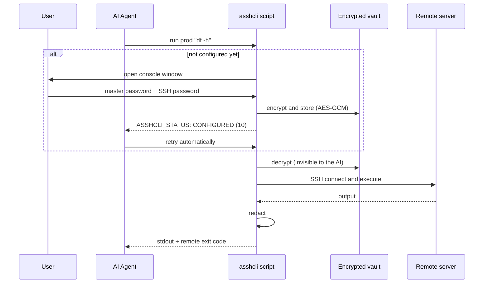

# asshcli

> Give your AI agent SSH access — **without ever putting the password into its context**.

[中文文档](README.md) · [](LICENSE)  

---

## Who this is for

- You use **Claude Code / Cursor / Windsurf / Cline / WorkBuddy** and want it to deploy to your server — without putting the SSH password into `.env` or a project config
- You want the agent to help debug production: read logs, check disk, restart a service
- Your security policy says production credentials must never reach a third-party AI service
- You use several AI tools and refuse to configure the same password over and over
- You want the agent restricted to read-only commands — no `rm -rf`, no `shutdown`
- You want to grant temporary server access and still be able to audit what was run

## The problem

To let an agent connect to a server, the usual path is to put the password in a
config file, an environment variable, or paste it straight into the chat.

**Once you do that, the password is in the model's context.** It shows up in the
conversation transcript, the request logs, and possibly the model's memory.

asshcli takes a different route: **the password goes through the script, never
through the AI.**

You type it once in a separate console window. The script encrypts it into a
local vault. When the agent calls `run prod "df -h"`, the script decrypts,
connects, and executes. The agent never sees the plaintext — and never needs to.
(Team-shared dev/test credentials are an explicit opt-in — declared plaintext or
encrypted, see section 12.)

## Compared to just giving the AI the password

| | Password in the prompt | With asshcli |
|---|---|---|
| Password enters the conversation context | Yes | **No** |
| Password visible in process list / shell history | Maybe | **No** |
| Remote command echoes the password | Lands in context as-is | **Replaced with `[REDACTED]`** |
| Reconfigure for every new agent | Yes | **No — one shared vault** |
| Restrict which commands the agent may run | No | **Allow / deny rules** |
| Audit who connected and what ran | No | **Audit log** |
| Pollutes system Python | Depends | **No — isolated venv** |

## Features

### 1. The password never enters the AI context

Typing happens in a separate console window, with `getpass` suppressing echo.
After the window closes, the password exists only as ciphertext on disk. No call
the agent makes can read it — not the status lines, not the command output, not
the audit log.

### 2. Configure once, share across every agent

Configuration lives at `~/.asshcli/`, **independent of where the skill is installed**.

Install this skill in Claude Code, Cursor, and WorkBuddy, and all three read the
same vault. They don't overwrite each other, and you never re-enter the password.
Ten copies still means one configuration.

### 3. Zero-config first run

No `init` step, no hand-written config file.

On the first call the script notices the vault is missing, opens a console
window, and asks for the master password plus the first server. When the window
closes, the agent receives a "configured" status and retries automatically.
From the user's side it just looks like the AI paused for a moment.

### 4. A status-code protocol — the AI knows what to do

When the script can't run the command, it returns a reserved exit code plus a
status line on stderr:

```
ASSHCLI_STATUS: TIMEOUT
ASSHCLI_MESSAGE: configuration window timed out
ASSHCLI_HINT: ask the user to run: python "..." config
```

| Status | Code | What the agent should do |
|---|---|---|
| `CONFIGURED` | 10 | Retry the command |
| `HOST_ADDED` | 14 | Retry the command |
| `SETUP_PENDING` | 15 | A config window is open, the user is typing; don't re-invoke — wait for the user, then retry once |
| `CANCELLED` | 11 | Stop; tell the user it was cancelled |
| `TIMEOUT` | 12 | Relay the command from `ASSHCLI_HINT` to the user |
| `LOCKED` | 13 | Suggest `unlock` |
| `NO_RUNTIME` | 20 | Follow the hint to fix the runtime |

No guessing, no trial and error.

### 5. No pollution of system Python

First run creates an isolated venv at `~/.asshcli/venv` and installs dependencies
there. Every later call reuses it. Your system Python stays untouched.

**Several agents bootstrapping at once only build it once**: venv creation and
`pip install` are serialized behind a dedicated bootstrap lock
(`~/.asshcli/.bootstrap`); later processes wait, re-check, and reuse the result.
Without it two processes would `rmtree` and `pip install` over each other and
leave a venv that never works. Waiting past 300 s returns `NO_RUNTIME` with the
reason instead of hanging.

### 6. Restrict what the agent can run — and which files it can touch

Add rules per host. Command rules are regexes that must match the **entire**
command (`fullmatch`); file rules are matched against the **remote path**:

```toml
[hosts.prod.policy]
allow     = ['^df -h$', '^systemctl status.*', '^docker ps$']
deny      = ['^rm -rf.*', '^shutdown$', '^mkfs.*']
allow_put = ['^/tmp/', '^/etc/nginx/conf\.d/']
allow_get = ['^/var/log/']
deny_put  = ['^/etc/']
```

| Field | Governs | Matched against |
|---|---|---|
| `allow` / `deny` | commands run via `run` | the whole command (`fullmatch`) |
| `allow_put` / `deny_put` | uploads via `put` | the remote **destination** path |
| `allow_get` / `deny_get` | downloads via `get` | the remote **source** path |

Rules:

- Command rules use `fullmatch`, not "contains". `allow = ['^df -h$']` permits
  `df -h` but not `x; df -h`; `^rm -rf` only blocks a command that is exactly
  `rm -rf` — write `^rm -rf.*` to block the family.
- File rules are regex `search` against the remote path — they match
  **anywhere** unless anchored. `allow_get = ['^/var/log/']` only permits paths
  starting with `/var/log/`; written without the anchor (`'/var/log/'`) it would
  also permit `/home/x/var/log/…`. `deny` rules follow the same semantics.
- **Commands containing shell metacharacters (`;` `&` `|` `$` backtick `>` `<`
  newline) are refused by default**, because they can turn one command into a
  chain and defeat any whole-string rule. If you need them (e.g. `2>/dev/null`,
  `a && b`), set `allow_shell = true` in that host's section.
- When an allow-list is present, anything unmatched is refused; `deny` wins over `allow`.
- **A host with an `allow` command list has its file channel closed by default.**
  You must add `allow_put` / `allow_get` explicitly — otherwise a box that only
  permits `df -h` could still be emptied with `get /etc/shadow`.
- Hosts with only `deny` rules keep file transfer working, unless the path
  matches `deny_put` / `deny_get`.
- A refusal happens before connecting, returns exit code 1, and writes a `*.denied`
  audit record.

### 6.1 What these rules are (and are not): prevents slips, not a security boundary

- `hosts.toml` and the code under `scripts/` are writable by any process running
  as the same OS user. An agent that wants to get around the rules can edit the
  file or import `lib.transport` directly.
- So the local policy **prevents slips, not a security boundary**: it adds friction
  and an audit trail to accidents like a stray `rm -rf` or `get /etc/shadow`, and
  it cannot stop a caller that deliberately bypasses it.
- Real enforcement can only live on the server (restricted `authorized_keys` plus
  a server-side wrapper). That is not part of the default baseline mode, and this
  README does not claim the agent is "restricted".
- Likewise the audit log is a record, not tamper protection: the same user can edit it.

### 7. Automatic output redaction

If a remote command prints the password — a stray `echo $PASS`, a `cat` of some
config file — it is replaced with `[REDACTED]` before reaching the agent.

### 7.1 Output is capped (50 KiB by default)

Agent context is expensive and easy to drown: `cat` of a big file, `find /`, a
build log — thousands of lines that push out what actually matters and get billed
per token. So `run` returns at most **50 KiB**, keeping the head and the tail and
replacing the middle with one line:

```
[asshcli] 输出已截断（原始 1834221 字节，只保留开头约 30720 与结尾约 20480 字节）；…
```

- `--tail N` returns just the last N lines (the usual debugging case)
- `--max-bytes N` changes the cap, `0` means unlimited
- remote stderr gets the same treatment
- the truncation and the original size go into the audit log (`truncated` / `bytes`),
  so later you can tell "that run produced 1.8 MB" from "we only returned this much"

### 8. Audit log

Every action that touches credentials or a remote host appends a JSONL record.
Commands and paths are redacted before being written, so the log never contains
a password.

| action | Recorded |
|---|---|
| `run` / `run.denied` | command executed or refused, exit code, duration, auth (`password` / `key` / `shared`; plus `fallback: key` when key auth fell back to password); `truncated` + original byte count when capped |
| `transfer.put` / `transfer.get` / `transfer.denied` | direction, local and remote paths, byte count, result |
| `test` | which machine was probed, and the result |
| `setpass` | which host's password changed (never the password) |
| `rename` | host rename: old → new, plus which credential entries moved (never the secrets) |
| `unlock` | unlock events, including failed automatic attempts |
| `vault.open` | every successful decryption: pid, interpreter, working directory, first two argv tokens |

```bash
python scripts/asshcli.py audit -n 20
```

### 9. Host key TOFU

The host key is recorded on first connect and verified strictly afterwards. If
the target machine is swapped out, you get a clear error instead of a silent
connection elsewhere.

### 10. Project-level host list (team-shared, travels with git)

Host definitions can live in `.asshcli/hosts.toml` at the project root. Commit
it and the whole team shares it: after cloning, each member only sets their
own master password on first use — addresses, accounts and policies come with
the repo; per-host passwords are asked on first connection.

Hand-editing works, and so does the `config` wizard: pick **project level**
when adding a host and confirm the project root (defaults to the detected
project; relative paths accepted) — the wizard writes the entry into the
project list. The password prompt is optional: leave it empty (type it on
first connect), store it in your personal vault (just you), or share it as
`shared_password_enc` encrypted with a team passphrase (passphrase never
enters the repo). Run `git diff` before committing.

```toml
# <project root>/.asshcli/hosts.toml — hand-editable, commit to git, no reseal
[hosts.prod]
host = "203.0.113.10"
user = "deploy"
port = 2222
description = "production"

[hosts.prod.policy]
deny = ["^rm -rf.*"]

# optional: per-host overrides (unset keys use defaults)
[hosts.prod.settings]
connect_timeout = 30.0
transfer_max_bytes = 536870912   # 512 MiB
```

Rules and boundaries:

- **Private keys never go project-level** (in any form); passwords may be
  shared via explicit declaration (`shared_password` tiers, see below) — that
  is a grant, not a leak. A `password` key in the project list is still
  warned about and ignored (it signals a mistyped field name)
- **Same-name hosts: user-level wins** (personal lists are cheapest to
  change): the user-level entry shadows the project one **as a whole**,
  including policy and settings; `list` shows the source as `override`.
  To keep your copy under its own name, `manage rename <old> <new>` moves the
  credentials along (nothing to re-enter) and unshadows the project entry
- **The project list is unsigned**: git history / PR review is its integrity
  layer; a broken file fails closed (connections refused, file named)
- Per-host settings keys: `connect_timeout` / `command_timeout` /
  `transfer_max_bytes` / `transfer_timeout` (seconds / bytes, positive)
- **Cloning means trusting that project's host definitions**: first connects
  still announce the TOFU fingerprint — glance at it before proceeding

**Team-member onboarding (three shapes, depending on the project list):**

| Project host has | What the member does |
|---|---|
| Address / policy only | Set master password once; type each host's password on its first connect |
| `shared_password` (plaintext) | **Nothing** — clone and use |
| `shared_password_enc` (encrypted) | Master password once, then one `manage teamkey set <team-id>` |

#### Shared passwords (non-secret dev/test hosts only): two tiers

When an internal dev/test password is not a secret to anyone who can clone,
you can declare it shared. Pick a tier per host:

| | Plaintext `shared_password` | Encrypted `shared_password_enc` |
|---|---|---|
| Onboarding | clone and use — no vault needed | master password + team passphrase once, then seamless |
| On repo leak | passwords leak with git history | only ciphertext leaks |
| Agent's view | declared boundary (by convention) | same grade as personal passwords (in-process decrypt, audited) |

**Plaintext tier** (true zero-touch):

```toml
[hosts.devbox]
host = "10.66.0.5"
user = "dev"
shared_password = "dev-only-123"   # quote it even if numeric
```

**Encrypted tier** (multi-team: the blob carries its own team id — one person
in N teams stores N passphrases; leaking one team's passphrase only affects
that team):

```toml
[hosts.devbox]
host = "10.66.0.5"
user = "dev"
shared_password_enc = "asshcli1:platform:AQID…:iRbF…"
```

Team-side one-time setup (the encrypter can also use the `config` wizard —
project level, choose "project shared" for the password — which writes the
ciphertext into the project list directly):

```bash
# The encrypter (CLI route): produce the ciphertext line, paste into the
# project list, commit via git
python scripts/asshcli.py manage sharepw set devbox

# Every member: store the team passphrase once (goes into the personal vault)
python scripts/asshcli.py manage teamkey set platform
python scripts/asshcli.py manage teamkey list   # which teams are stored
```

This is not encryption theater — **the key (team passphrase) never enters the
repo**; decryption happens only inside the asshcli process, giving encrypted
shared passwords the same protection grade as personal vault passwords.

**What teamkey is**: your team passphrase lives in **your personal vault** as
`teamkey:<team-id>`, unlocked with your master password; `manage teamkey list`
shows team IDs only, **never the passphrase**. Both the wizard ("project
shared") and `sharepw set` reuse a stored passphrase so it matches what other
members use to decrypt.

**Rotation**: change the shared password by re-running `sharepw set` (new
ciphertext, same passphrase); change the team passphrase by running
`manage teamkey set` first to overwrite it with the new one, then re-running
`sharepw set` on every host — the order matters, otherwise re-encryption
still uses the old passphrase.

**Forgot the team passphrase?** Depends on where you stand:

- **Only you forgot it, others remember**: ask the encrypter or any member
  for the passphrase, re-run `manage teamkey set <team-id>` to overwrite your
  copy — no ciphertext changes, retry the command
- **The encrypter forgot, but some member has it stored**: have that member
  re-run `sharepw set` for fresh ciphertext, or have them tell you the
  passphrase and follow the previous bullet
- **Everybody forgot**: the ciphertext is unrecoverable — that is the flip
  side of "the passphrase never enters the repo". Go back to the hosts:
  change the passwords on the servers themselves, then `manage teamkey set`
  with a new passphrase and re-run `sharepw set` per host; if you stop
  sharing, delete the ciphertext lines and each member types their own
  password on first connect
- **Forgot your master password is a different matter**: it unlocks your own
  vault (where teamkey lives) and cannot be recovered — delete the vault and
  start over, then `manage teamkey set` once more (ask a teammate for the
  passphrase); the ciphertext never needs to change

Rules shared by both tiers (credentials follow the winning entry, shadow to
use your own, `auth=shared` audit, `共享` column, redaction) as above; the
two fields on one host are rejected (ambiguous security intent). **Only
non-secret credentials; keys are never shared** (no private-key form at
project level, ever).

## Quick start

### 1. Install

**Option A — download the release** (simplest)

Grab `asshcli-skill-vX.Y.Z.zip` from [Releases](https://github.com/Hayuuka/asshcli/releases/latest)
and unzip it into a skills directory:

- User level (all projects): `~/.workbuddy/skills/asshcli/`
- Project level (shared with the team): `<project>/.workbuddy/skills/asshcli/`

**Option B — git clone**

```bash
git clone https://github.com/Hayuuka/asshcli.git ~/.workbuddy/skills/asshcli
```

### 2. Use it

Ask the AI "connect to prod and check disk usage", or run it yourself:

```bash
python scripts/asshcli.py run prod "df -h"
```

The first call opens the configuration window. Once you're done, it connects.
The window is a separate process — the AI's command finishing or timing out does
not close it, so you can take your time.

If the window does get closed, use this instead — everything happens in your
current terminal, no new window:

```bash
python scripts/asshcli.py config --here
```

You only do this once; every later call connects directly, no window involved.

## Where your data lives

Everything is under `~/.asshcli/` — **not inside the skill directory**, so
upgrading or reinstalling the skill never touches your configuration.

| Path | Contents |
|---|---|
| `~/.asshcli/vault.enc` | Encrypted passwords and private-key entries (AES-GCM + scrypt). Useless without the master password, and **the header does not list entry names** |
| `~/.asshcli/hosts.toml` | Host list, port, user, policy rules, with an HMAC integrity seal. **No password field** |
| `~/.asshcli/known_hosts` | Host key fingerprints (TOFU) |
| `~/.asshcli/audit.log` | JSONL audit trail, redacted |
| `~/.asshcli/console.log` | Diagnostics for the config window — flow and exceptions only, never your input |
| `~/.asshcli/venv/` | Isolated runtime, ~35 MB, created once |
| `~/.asshcli/.lock` | Cross-process file lock |

On Windows that is `C:\Users\<you>\.asshcli\`. The master password itself is kept
in the OS credential store — Windows Credential Locker, macOS Keychain, or
Secret Service on Linux.

To move to another machine, copy `~/.asshcli/` **excluding `venv/`** (the runtime
rebuilds itself on first use). The master password stays the same and
`vault.enc` works as-is; the entry in the OS credential store, however, is
indexed by a path hash, so the new machine won't find it — you'll be asked to
unlock once (`asshcli unlock`) on first use. No host re-configuration needed.

Forgot the master password? **Reset only the vault — the host list needs no
re-entry.** Steps in the FAQ at the bottom.

## How it works



## SSH keys (optional, key-first)

Besides passwords, asshcli supports SSH key authentication. Private keys live
**only inside the encrypted vault** (`key:<host>` entries) and are loaded into
memory at connect time — a plaintext key never touches the disk.

```bash
python scripts/asshcli.py manage keygen prod      # generate Ed25519, prints the public key line
python scripts/asshcli.py manage keyimport prod ~/.ssh/id_ed25519  # import an existing key
python scripts/asshcli.py manage keyshow prod     # show public key line + SHA256 fingerprint
```

- Deploying the public key is manual for now: append the printed line to the
  server's `~/.ssh/authorized_keys` (on Windows admins:
  `administrators_authorized_keys`, mind the ACL). One-click restricted-key
  deployment belongs to the hardening tier (on the watchlist).
- Connections try the key first and fall back to the password. A fallback is
  visible: `fallback: key` in the audit log plus a stderr notice — so a
  silently removed server-side public key shows up in your audit trail.
- The legacy `key_file` field in `hosts.toml` no longer authenticates (it
  would be a vault-bypassing backdoor for an AI that can edit the file);
  `manage keyimport` accepts it as the migration path.

## Commands

Execution layer (for the agent — see SKILL.md):

| Command | Purpose |
|---|---|
| `run <host> <command>` | Execute remotely; exit code passed through |
| `list` | List configured hosts (source column: user / project / override) |
| `test <host>` | Connectivity check |
| `put` / `get` | Upload / download files |
| `status` | Show data directory, vault, host and project lists |

Management layer (for the user — `manage <subcommand>`):

| Subcommand | Purpose |
|---|---|
| `manage setup` | Install the runtime only |
| `manage hosts` | List hosts (same as `list`) |
| `manage setpass <host>` | Change one host's password |
| `manage unlock` | Re-enter the master password |
| `manage keygen <host> [--force]` | Generate an Ed25519 keypair (private key encrypted into the vault, public key printed) |
| `manage keyimport <host> [file]` | Import an existing private key into the vault |
| `manage keyshow <host>` | Show the host's public key line and fingerprint |
| `manage teamkey set <team-id>` | Store a team passphrase — the decryptor for encrypted shared passwords (section 10; the `list` subcommand shows stored teams) |
| `manage sharepw set <host>` | Encryption ceremony: emit a `shared_password_enc` line to paste into git (section 10) |
| `manage reseal` | Re-sign hosts.toml after hand-editing (integrity check, section 11) |
| `manage rename <old> <new> [--force]` | Rename a user-level host: the list entry (policy / settings included) and the vault's password / key entries move together and the file is re-signed automatically — **no credential re-entry**; project-level entries are renamed via git. `--force` overwrites leftover orphan entries under the new name |
| `manage policy <host>` | Show the host's effective policy |
| `manage audit [-n N] [--all]` | Show audit records (`--all` includes `vault.open` decryption traces) |
| `manage harden <host> --check` | Read-only probe of server-side hardenability |

Old top-level spellings remain as aliases (`asshcli setpass prod` ≡
`asshcli manage setpass prod`; `ls` ≡ `list`). To add a host: tell the AI
"connect to <name>", or run `asshcli config` (`--here` stays in the current
terminal, no new window).

Common flags:

```bash
python scripts/asshcli.py run prod --sudo "systemctl restart nginx"
python scripts/asshcli.py run prod --timeout 600 "make build"
python scripts/asshcli.py run prod -- tail -n 100 /var/log/nginx/error.log

# feed stdin to a remote command (never via argv, so never in ps or the audit log)
cat schema.sql | python scripts/asshcli.py run prod --stdin - "mysql -u app"
python scripts/asshcli.py run prod --stdin-file./schema.sql "mysql -u app"
```

`put` / `get` also enforce **local** path rules, so one transfer cannot wreck the
local setup:

| Rule | Detail |
|---|---|
| `get` target | Must be inside the current directory or `~/.asshcli/tmp/`. Writing into `~/.asshcli/` is refused — otherwise one `get` could overwrite `hosts.toml`, `known_hosts` or `vault.enc` |
| `put` source | Must live outside `~/.asshcli/` (or the vault ciphertext could be shipped off-box) and must exist |
| Size | 64 MiB per transfer by default; exceeding it is an error with the exact flag to raise it, never a silent truncation |
| Duration | 300 s per transfer by default; a stalled peer errors out instead of hanging |

Both limits can be raised per call with `--max-bytes` / `--timeout`. Paths are
compared after `realpath`, so symlinks and `..` do not slip through, and a failed
transfer deletes the partial file instead of leaving a convincing-looking one.

## Security model

**What it protects against**

- The AI casually reading a config file and finding the password
- The password entering the conversation context, logs, or shell history
- The password showing up in the process list (`ps` / Task Manager)
- The remote host echoing the password back
- Error messages leaking credentials on auth failure
- Multiple agents overwriting each other's configuration

**What it does not protect against** (stated plainly)

- **Local policy can be bypassed**: `hosts.toml` and `scripts/` are writable by
  the same user, so `lib.transport` can be called directly, or the vault can be
  unlocked and the host list re-sealed via internal modules. The integrity seal
  on `hosts.toml` raises the cost of editing policy away and makes it fail
  closed, but it prevents slips, not a security boundary (see 6.1).
- **The audit log can be rewritten** by the same user: it is a record, not tamper protection.
- A program that already has your OS account privileges can call this project's
Python API and decrypt the vault. One line of
`python -c "from lib import vault; vault.open_vault"` is enough. That is an
operating-system boundary; no local tool can cross it.

To be airtight you would keep the master password in your head and type it every
time — but then the agent can't run unattended.

The real improvement is this: **for the AI to steal the password, it has to
actively write code against internal APIs** rather than just read a file. Every
successful decryption appends a `vault.open` audit record (pid, interpreter,
working directory, first two argv tokens), so that path **cannot be blocked, but it does leave a
trail** you can inspect afterwards.

## FAQ

**The config window closes by itself right after opening.**

Some hosts put every command in a job object and reap leftover processes when the
command ends — the window gets killed along with it. The window is now launched by
**Windows Explorer**, so it is not in the script's process tree or job object: the
script exiting, or the AI's command timing out, will not close it, and anything
you were typing is safe.

If it disappears anyway (say you closed it), asshcli falls back to a window-free path:

```bash
python scripts/asshcli.py config --here
```

Every window start and exception is logged to `~/.asshcli/console.log`.

**I forgot the master password.**

The vault is unrecoverable — that's what encryption means. But **do not delete
the whole `~/.asshcli/`** — the host list does not need re-entry; reset only
the vault:

1. Delete `~/.asshcli/vault.enc` (on the gpg backend delete
   `~/.asshcli/master.gpg` too)
2. `asshcli config` to set a new master password (the wizard detects the
   missing vault and runs initialization)
3. `asshcli manage reseal` — the list's seal key derives from the master
   password, so the new vault cannot verify the old seal (reads fail closed);
   after confirming the list wasn't tampered with, this re-seals it with the
   new key
4. Reconnect as you go: `run <host>` triggers first-connect password entry,
   or pre-fill with `asshcli setpass <host>`

What you lose is only what was in the vault: host passwords, hosted private
keys (re-run `manage keygen --force` and redeploy the public keys), team
passphrases (ask a teammate, then `manage teamkey set` — the ciphertext never
changes, see §10). What you keep: `hosts.toml` (hosts / ports / policies),
`known_hosts` (no TOFU re-announcement), audit logs; the project-level list
lives at the project root and is unaffected.

**PyPI is blocked on my network.**

```bash
set PIP_INDEX_URL=https://pypi.tuna.tsinghua.edu.cn/simple
python scripts/asshcli.py setup
```

Or any other mirror you can reach.

**Several machines share the same password — can I enter it once?**

No. Each host's password is stored under its own name; run `asshcli setpass db1`
and `asshcli setpass db2` separately (same value is fine). hosts.toml has no
password field and no cross-host reference — deliberate: the host list stays
secret-free, passwords live only in vault.enc. Sharing across **agents** needs
nothing extra: every agent reads the same `~/.asshcli/`, one configuration for all.

**How does sudo work?**

Set `sudo = true` on the host, or pass `--sudo`. The password goes to `sudo -S`
over stdin — never on the command line.

**Does `python` have to exist?**

Python 3.9+ is required. Note that if the `python` command doesn't exist at all,
the script never starts and cannot report anything — you'll need to install
Python yourself first. If Python exists but is older than 3.9, the script will
tell you to upgrade.

## Development

```bash
# dependencies
py -3.14 -m venv.venv.venv/Scripts/python.exe -m pip install paramiko cryptography keyring tomli-w "tomli; python_version < '3.11'"

# tests (780+ assertions, one file per functional module — see tests/README.md)
.venv/Scripts/python.exe tests/test_flow.py      # main flow and status codes
.venv/Scripts/python.exe tests/test_policy.py    # command policy semantics and bypasses
.venv/Scripts/python.exe tests/test_redact.py    # output redaction
.venv/Scripts/python.exe tests/test_audit.py     # audit hygiene and filtering
.venv/Scripts/python.exe tests/test_vault.py     # vault format and master-passphrase backends
.venv/Scripts/python.exe tests/test_transport.py # connections / host keys / transfer limits
.venv/Scripts/python.exe tests/test_protocol.py  # status-line protocol (nonce)
.venv/Scripts/python.exe tests/test_output.py    # output truncation
.venv/Scripts/python.exe tests/test_console.py   # setup wizard and guidance text
.venv/Scripts/python.exe tests/test_integrity.py # hosts.toml integrity signatures
.venv/Scripts/python.exe tests/test_sshkeys.py   # key management and key-first auth
.venv/Scripts/python.exe tests/test_manage.py    # manage subcommand dispatch and host rename
.venv/Scripts/python.exe tests/test_harden.py    # harden --check
.venv/Scripts/python.exe tests/test_runtime.py   # interpreter management hygiene
.venv/Scripts/python.exe tests/test_paths.py     # data-dir gating
.venv/Scripts/python.exe tests/test_project.py   # project list / shared-password tiers
.venv/Scripts/python.exe tests/test_lock.py      # cross-process locking
.venv/Scripts/python.exe tests/test_store.py     # hosts.toml read/write
.venv/Scripts/python.exe tests/test_reexec.py    # interpreter re-exec semantics (Windows execv)
py -3.14 tests/test_docs.py                     # docs/code consistency
```

Tests spin up a local SSH server for real connections — no external network needed.

The tests spin up a real local SSH server — no mocks, no network needed.

## License

[MIT](LICENSE)

---

<details>
<summary><b>Keywords</b> — to help people find this</summary>

<br>

ssh for ai agents · ai agent ssh access without password · claude code ssh access ·
cursor ssh server · windsurf ssh · cline ssh · aider ssh · mcp ssh server ·
credential broker for llm · secret injection for ai agents ·
ai coding agent deploy to server · agent safe credentials ·
password never reaches llm · keep secrets out of prompt · ai devops assistant ·
remote server access for ai · ai agent run shell command remotely ·
secure ssh proxy for llm · ai ops automation · ssh key management for agents ·
agent credential vault · ai agent password manager

</details>
