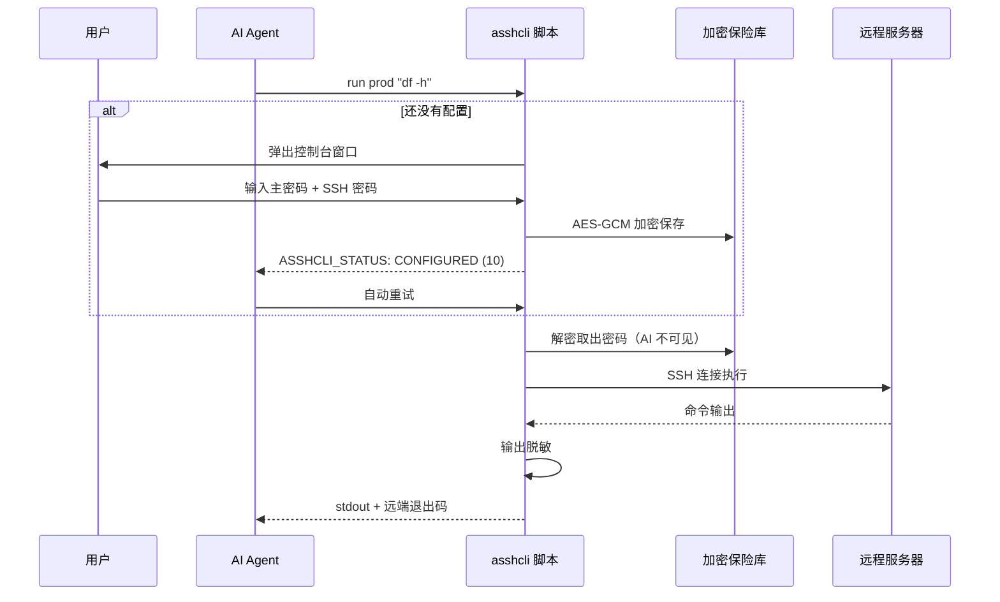

# asshcli

[English](README.en.md)
[](LICENSE)


使用AI连接服务器时，不敢直接把ssh用户密码直接丢给ai？
让 AI 能连你的 SSH 服务器，但它**永远看不到你个人保存的密码**（团队共享的dev/test 凭据可选明示声明或加密，见第 12 节）。
一次配置，多agent共用。**新手 5 分钟上手 → 直跳[快速开始](#快速开始)。**

---

## 适用场景

- 让 **Claude Code / Codex / DSH / Zcode / WorkBuddy** 这类 AI 编程助手帮你把代码部署到服务器，又不想把 SSH 密码写进 `.env` 或项目配置
- 让 AI 帮忙排查线上问题：看日志、查磁盘、看服务状态、重启服务
- 公司安全要求「生产环境密码不能进入任何第三方 AI 服务」
- 同时用好几个 AI 工具，不想为每个都配一遍密码
- 想限制 AI 只能跑只读命令，禁止 `rm -rf`、`shutdown`（防手滑，不是安全边界，见 6.1）
- 给 AI 临时开一次服务器权限，事后能查它到底跑了什么

## 为什么需要它

现在很多人让 AI agent 帮忙上服务器排障、看日志、重启服务。为了让它能连，通常只能把密码写进配置文件、环境变量，或者直接贴在对话里。
**一旦这样做，密码就进了 AI 的上下文** —— 它会出现在对话记录、请求日志、甚至被模型记住。

asshcli 换了个做法：**密码只经过脚本，不经过 AI**。

密码由用户在一个独立的控制台窗口里输入，脚本加密存进本地保险库。
AI 调用时只说「连 prod」，脚本自己去解密、连服务器、执行命令。AI 全程接触不到明文，也不需要接触。

## 和直接把密码给 AI 的区别

| | 直接把密码给 AI | 用 asshcli |
|---|---|---|
| 密码进入对话上下文 | 是 | **否** |
| 密码出现在进程列表 / 命令历史 | 可能 | **否** |
| 远程回显了密码怎么办 | 原样进入上下文 | **自动替换成 `[REDACTED]`** |
| 换一个 agent 要重新配吗 | 要 | **不用，共用一份** |
| 能限制 agent 跑什么命令吗 | 不能 | **白名单 / 黑名单** |
| 事后能追溯谁连了什么吗 | 不能 | **审计日志** |
| 装 skill 会污染系统 Python 吗 | 视实现而定 | **不会，独立 venv** |

## 特性

### 1. 密码永不进入 AI 上下文

密码在独立的控制台窗口中由用户本人输入，`getpass` 屏蔽回显。
窗口关掉后密码只以密文形式存在于本地，AI 的任何调用都读不到它。

详情：状态行、命令输出、审计日志里都不会出现密码。

### 2. 一次配置，所有 agent 共用

配置固定存放在 `~/.asshcli/`，**与 skill 装在哪里无关**。

你在 Claude Code、Zcode、WorkBuddy 各装一份这个 skill，它们读的是同一份配置，不会互相覆盖，也不需要重复设置密码。装十份也只配一次。

### 3. 零配置启动

不需要先运行什么 `init`、也不用手写配置文件。

第一次让 AI 连服务器时，脚本发现没有配置，会自动弹出一个控制台窗口，让用户填主密码和服务器信息，填完窗口关闭，AI 收到「配置完成」状态后自动重试。
用户感知到的就是「AI 卡了一下，然后就连上了」。

### 4. 状态码协议 —— AI 知道该做什么

脚本不执行命令时，会返回明确的保留退出码并在 stderr 打出状态行：

```
ASSHCLI_STATUS: TIMEOUT
ASSHCLI_MESSAGE: 配置窗口等待超时
ASSHCLI_HINT: 请告诉用户在自己的终端里执行：python "..." config
```

| 状态 | 码 | AI 该做什么 |
|---|---|---|
| `CONFIGURED` | 10 | 重试刚才的命令 |
| `HOST_ADDED` | 14 | 重试刚才的命令 |
| `SETUP_PENDING` | 15 | 配置窗口开着、用户正在填；不要重复调用，等用户填完再重试一次 |
| `CANCELLED` | 11 | 停止，告诉用户已取消 |
| `TIMEOUT` | 12 | 把 hint 里的命令转告用户 |
| `LOCKED` | 13 | 建议用户 `unlock` |
| `NO_RUNTIME` | 20 | 按 hint 指引处理环境问题 |

不用猜，不用试错。

### 5. 不污染全局 Python

首次运行自动在 `~/.asshcli/venv` 建独立虚拟环境并安装依赖，之后所有调用都复用它。系统的 Python 环境一动不动。

**多个 agent 同时首跑也只会建一次**：建 venv + 装依赖全程由一把独立的自举锁（`~/.asshcli/.bootstrap`）串行化，后到的进程等前一个装完后复查、直接复用。
否则两个进程会同时 `rmtree` + `pip install`，互相把对方的半成品环境删掉，最后留下一个怎么都装不好的 venv。
等锁超过 300 秒会返回`NO_RUNTIME` 并说明原因，不会无限挂住。

### 6. 可以限制 AI 能跑什么命令、能碰哪些文件

在主机配置里加规则（正则；命令规则要求**整条命令**匹配，文件规则匹配**远端路径**）：

```toml
[hosts.prod.policy]
allow     = ['^df -h$', '^systemctl status .*', '^docker ps$']
deny      = ['^rm -rf.*', '^shutdown$', '^mkfs.*']
allow_put = ['^/tmp/', '^/etc/nginx/conf\.d/']
allow_get = ['^/var/log/']
deny_put  = ['^/etc/']
```

| 字段 | 管什么 | 匹配对象 |
|---|---|---|
| `allow` / `deny` | `run` 执行的命令 | 整条命令（`fullmatch`） |
| `allow_put` / `deny_put` | `put` 上传 | 远端**目标**路径（正则 `search`） |
| `allow_get` / `deny_get` | `get` 下载 | 远端**源**路径（正则 `search`） |

规则：

- 命令规则是 `fullmatch`，不是「字符串里出现过」。
  `allow = ['^df -h$']` 放行  `df -h`，放不过 `x; df -h`；写 `^rm -rf` 只能拦住**正好等于** `rm -rf` 的命令，要拦那一族就写 `^rm -rf.*`。
- 文件规则是正则 `search`，对远端路径**任意位置**匹配 —— 要按前缀限定，正则必须自带 `^` 锚点：
  `allow_get = ['^/var/log/']` 只放行 `/var/log/` 开头的路径；写成 `'/var/log/'`（无锚点）会连 `/home/x/var/log/…` 一起放行，`deny` 同理
- **命令里含 shell 元字符（`;` `&` `|` `$` 反引号 `>` `<` 换行）默认拒绝** —— 这类写法能把一条命令变成一串命令，让任何按整串写的规则失效。
  确实需要（例如 `2>/dev/null`、`a && b`）就在主机段里加 `allow_shell = true`，那时规则只对整条命令原样生效。
- 白名单非空时，不匹配就拒绝；`deny` 优先于 `allow`。
- **配了 `allow` 命令白名单的主机，文件通道默认关闭**，必须显式写`allow_put` / `allow_get` 才能传文件 —— 否则「只允许 `df -h`」的机器仍然能被 `get /etc/shadow` 掏空。
- 只配 `deny` 的主机，文件通道照常可用，除非路径命中 `deny_put` / `deny_get`。
- 被拒绝时不会连接主机，退出码为 1，并在审计日志里留一条 `*.denied` 记录。

### 6.1 这套规则的定位：防手滑，非安全边界

「能限制 agent 跑什么命令」这句话要说清楚，否则比没有更危险：

- `hosts.toml` 和 `scripts/` 下的代码，对**同一个操作系统用户**的进程都是可写的。
  agent 想绕开规则，改一行配置、或者直接 `import lib.transport` 都能绕。
- 所以本地策略是**防手滑**：让「顺手 `rm -rf`」「顺手 `get /etc/shadow`」这类误操作多一道摩擦、多一条审计记录，而不是一道拦得住有意者的墙。
- 真正的强制只能在服务端做（受限 `authorized_keys` + 服务端包装脚本），那才是 agent 无法绕过的边界。本项目当前默认档（基线模式）不含该能力，文档里不承诺「限制住了 agent」。
- 同理：审计日志同用户可改，是**留痕**不是防篡改。

这一段的取舍写进了 [docs/DESIGN.md](docs/DESIGN.md)（第 1、3 节），改措辞请先改那里。

### 7. 输出自动脱敏

远端命令如果把密码打出来了（比如误执行 `echo $PASS`、`cat` 了某个配置文件），转给 AI 之前会被替换成 `[REDACTED]`。

### 7.1 输出有长度上限（默认 50 KiB）

AI 的上下文很贵，也很容易被灌满：`cat` 一个大文件、`find /`、构建日志动辄几千行，真正有用的信息会被挤出去，还按 token 计费。所以 `run` 回传的输出默认截到**50 KiB**，保留头尾、中间换成一行提示：

```
[asshcli] 输出已截断（原始 1834221 字节，只保留开头约 30720 与结尾约 20480 字节）；
需要完整内容请缩小命令范围，或用 --max-bytes / --tail 调整
```

- `--tail N` 只回传最后 N 行（排障最常用）
- `--max-bytes N` 改上限，`0` = 不限制
- 远端 stderr 同样受限制
- 截断事件与原始大小会写进审计（`truncated` / `bytes` 字段），事后能看出「这次其实有 1.8 MB，只是被截了」

### 8. 审计日志

所有触达凭据或远端的动作都会记一条 JSONL。命令、路径写入前已脱敏，日志里不会有密码。

| action | 记什么 |
|---|---|
| `run` / `run.denied` | 执行或拒绝的命令、退出码、耗时、认证方式（`auth: password` / `key` / `shared`；密钥被拒回落密码时另记 `fallback: key`）；被截断时带 `truncated` 与原始字节数 |
| `transfer.put` / `transfer.get` / `transfer.denied` | 传输方向、本地与远端路径、字节数、结果、认证方式 |
| `test` / `test.denied` | 探测了哪台机器、结果如何；被策略拒绝时同样留记录 |
| `harden.check` | 加固只读探测的结果与阻塞项（`manage harden <主机> --check`） |
| `setpass` | 哪台主机的密码被改动（不含密码本身） |
| `rename` | 主机改名：旧名 → 新名与随迁的凭据项（不含凭据本身） |
| `unlock` | 解锁事件，含自动解锁失败的尝试 |
| `vault.open` | 每一次成功解密：调用方 pid、命令行前两个参数、工作目录 |

```bash
python scripts/asshcli.py audit -n 20
```

展示层默认隐藏 `vault.open` 解密留痕（正常使用只见业务动作）；
要查「谁在什么时候解开了密码库」用 `--all` 看全量 —— 文件本身全保真，一条不漏。日志超过 10 MiB 自动轮转出 `audit.log.1`（只留一代）。

### 9. 主机指纹 TOFU

首次连接自动记录主机密钥，之后严格校验。目标机被换掉时会明确报错，不会静默连到别处。首连时 stderr 会输出一行 `ASSHCLI_HOSTKEY: SHA256:…`，
AI 会把指纹念给你 —— 花几秒和 `ssh-keygen -lf`（或服务器控制台）对一下，能当场发现手误连错机器或 DNS 指向了别处。

指纹库（`~/.asshcli/known_hosts`）写坏了也**不会**退化成「谁都信」：解析不了就在发送凭据之前中止本次连接（退出码 4），并说明是哪一行坏了、该找用户确认。
写入是加锁 + 原子替换，多个 agent 同时首连不会互相写坏；每次只替换该主机自己的条目，手写注释和其它主机原样保留。

### 10. 密钥认证（可选，密钥优先）

密码之外支持 SSH 密钥：私钥**只以密文存在密码库**（`key:<host>` 条目），运行时从内存加载，进程退出即消失 —— 明文私钥不落盘（这是硬约束）。

```bash
# 生成（打印公钥行与指纹；私钥直接进密码库，不落任何明文文件）
python scripts/asshcli.py manage keygen prod
# 或导入已有私钥（PKCS8 / SEC1 / PKCS1 / OpenSSH 格式都可以，带口令的先
# 用 `ssh-keygen -p -f 私钥` 移除口令再导入）
python scripts/asshcli.py manage keyimport prod ~/.ssh/id_ed25519
# 重新查看公钥
python scripts/asshcli.py manage keyshow prod
```

- 公钥部署目前是**手动**的：把输出的公钥行追加到服务器的`~/.ssh/authorized_keys`（Windows管理员组用户是`administrators_authorized_keys`，注意 ACL 只留dministrators/SYSTEM）。
  一键部署受限公钥属加固档（观察名单）；`manage harden <主机> --check` 可以先探测服务器端条件
- 连接时**密钥优先、密码兜底**：密钥被服务器拒绝会自动回落到密码，并在审计日志写 `fallback: key`、在 stderr 提示 —— 服务器上的公钥被人拿掉时你能在审计里看到
- 密钥即使被偷，也只够登录这一台服务器，不像密码丢了要全网改

### 11. 主机清单的完整性签名

`hosts.toml` 对 AI 可写，「删掉策略段就永久豁免限制」是真实的攻击路径。
清单因此带 HMAC 签名（密钥从主密码派生）：

- 任何字段值被改动，签名就失配：所有连接类命令在建连前拒绝（退出码 3）并明确报错；**注释与排版不参与签名**，手编注释不会弄坏它
- 你本人手编 hosts.toml 后，检查内容无误，执行一次 `python scripts/asshcli.py manage reseal` 即可恢复
- 程序写入（向导加主机、迁移）会自动续签；签名失效的清单普通写入**不会**把它洗成「已验证」状态
- `list` / `status` / `manage policy` 不验签 —— 你需要它们在被改动的清单上先看看改了什么

### 12. 项目级清单（团队共享，随 git 走）

主机定义可以放进项目根的 `.asshcli/hosts.toml`，提交进 git 后全团队共享：
成员 clone 下来，第一次跑任意命令时只需设自己的主密码，主机地址、账号、策略全部随仓库就位，各台机器的密码首次连接时再单独补。
除了手编，也可以用 `config` 向导：添加主机时配置级别选「项目级」，向导会确认项目根目录（默认当前识别的项目，支持相对路径）后把主机写进项目清单；密码同样会问但可留空——填了还可选存到哪：个人密码库（仅自己，其他成员首连补录）或项目共享（团队口令加密成 shared_password_enc 写进清单，口令不进 repo）；留空则首次连接时补录。写完记得 git diff 检查后提交。

```toml
# <项目根>/.asshcli/hosts.toml —— 手编或用 config 向导（选「项目级」），提交进 git，无需 reseal
[hosts.prod]
host = "203.0.113.10"
user = "deploy"
port = 2222
description = "生产"

[hosts.prod.policy]
deny = ["^rm -rf.*"]

# 可选：这台机器慢，给宽一点的连接与传输限额（未配置的键用默认值）
[hosts.prod.settings]
connect_timeout = 30.0
transfer_max_bytes = 536870912   # 512 MiB
```

规则与边界：

- **私钥永不下沉到项目级**（任何形态）；密码可经用户显式声明（shared_password 两档，见下）随项目共享——风险由用户自行判断。
  项目清单里出现 `password` 键仍会被警告且不生效（那是写错字段名的信号）
- **同名主机用户级优先**（个人的可随意改、修改成本最低）：同名时用户级条目**整条**遮蔽项目级（含策略与 settings），`list` 的来源列显示「覆盖」；
  要给项目主机加个人策略，在 `~/.asshcli/hosts.toml` 里定义同名条目；想把自己的副本独立命名，用 `manage rename <旧名> <新名>`（凭据随迁不用重录，项目条目同时解除遮蔽）
- **项目清单不签名**：git 历史 / PR 评审就是它的完整性层；解析失败会 fail-closed（拒绝连接并指明文件与原因）
- 主机可自定义的 settings 键：`connect_timeout` / `command_timeout` / `transfer_max_bytes` / `transfer_timeout`（秒 / 字节，正数；用户级与项目级条目都可用）
- **clone 即信任该项目的主机定义**：首次连接仍会有 TOFU 指纹播报，看一眼再继续，别连到陌生机器上

**团队成员上手（三种形态，取决于项目清单怎么写）：**

| 项目主机配了什么 | 成员要做什么 |
|---|---|
| 只有地址/策略（无共享字段） | 首跑设一次主密码；每台主机首次连接时在向导里输它的密码 |
| `shared_password`（明文） | **什么都不用做**，clone 完直接用，**风险自担** |
| `shared_password_enc`（加密） | 首跑设主密码，再执行一次 `manage teamkey set <团队ID>`（口令问加密者要） |

#### 共享密码（两档）

内网开发 / 测试环境的主机密码对“能 clone 的人”本来就不是秘密时，可以显式声明为共享。有两个档位，按主机的风险自己选：

| | 明文档 `shared_password` | 加密档 `shared_password_enc` |
|---|---|---|
| 上手 | clone 即用，连密码库都不需要 | 首跑设主密码 + 一次团队口令，之后零感知 |
| repo 泄漏时 | 密码随 git 历史泄漏 | 只泄漏密文 |
| agent 视角 | 声明边界（约定不读） | 与个人密码同级（进程内解密 + 留痕） |

**明文档**（真·零交互）：

```toml
[hosts.devbox]
host = "10.66.0.5"
user = "dev"
shared_password = "dev-only-123"   # 数字密码也要加引号
```

**加密档**（多团队：密文自带团队 ID，一人参与 N 个团队就存 N 条口令，泄漏一个团队只波及该团队）：

```toml
[hosts.devbox]
host = "10.66.0.5"
user = "dev"
shared_password_enc = "asshcli1:platform:AQID…:iRbF…"
```

团队侧流程（一次）。
加密者也可以用 `config` 向导（项目级 + 密码存到哪选「项目共享」），向导会确认团队 ID 与口令后直接把密文写进项目清单，效果相同；
命令行方式：

```bash
# 加密者：生成密文行，粘贴进项目清单提交 git
python scripts/asshcli.py manage sharepw set devbox

# 每个成员：各自存一次团队口令（进个人密码库，随主密码自动解锁）
python scripts/asshcli.py manage teamkey set platform
python scripts/asshcli.py manage teamkey list   # 看存过哪些团队
```

这不是加密表演——**密钥（团队口令）不进 repo**，解密只发生在 asshcli 进程内，加密档共享密码获得与个人 vault 密码完全同级的防护。

**teamkey 是什么**：你的团队口令存在**你个人的密码库**里，键名 `teamkey:<团队ID>`，随主密码自动解锁；`manage teamkey list` 只列团队 ID，**不显示口令**。向导选「项目共享」和 `sharepw set` 都会优先复用已存的口令，保证与成员的解密侧一致。

**轮换**：改共享密码 = 有口令的人重跑 `sharepw set`（密文换了、口令不变）；换团队口令 = 先 `manage teamkey set` 覆盖存新口令，再逐台重跑 `sharepw set` 重加密——顺序不能反，否则重加密仍用旧口令。

**忘了团队口令怎么办**（按你处在哪一侧）：

- **只是自己忘了，别人记得**：向加密者或任一成员要口令，重跑 `manage teamkey set <团队ID>` 覆盖自己的副本——密文一个都不用动，重试原命令就通
- **加密者忘了，但有成员存着**：让任一存有口令的成员重跑 `sharepw set` 出新密文；或他把口令告诉你，回到上一条
- **所有人都忘了**：密文不可恢复（这正是「口令不进 repo」的另一面——谁也不能从仓库里把它找回来）。回到主机本身：用服务器侧手段改密码，然后 `manage teamkey set` 存新口令、逐台重跑 `sharepw set` 重新加密；不再共享就删掉密文行，各成员首连时补录自己的密码
- **主密码忘了是另一回事**：主密码解开的是你自己的密码库（teamkey 存在里面），本身找不回，只能删库重来；重建后再 `manage teamkey set` 一次（口令问队友要），密文依旧不用动

两档共同的规则（凭据随生效条目走、要用个人密码先 shadow、auth=shared 审计、「共享」列、脱敏）见上文；两字段并存会被拒绝（安全意图歧义）。
**只放非秘密凭据；私钥永不共享**（项目级不支持任何私钥形态——密钥泄漏要清理它部署过的每台机器，后处理成本与共享面不匹配）。

## 快速开始

### 1. 安装

**方式一：AI 安装**

给AI发送：帮我安装 https://github.com/jurnlee/asshcli.git 这个技能到本地

**方式二：下载发布包**

从 Releases 下载 `asshcli-skill-vX.Y.Z.zip`，
解压到 skills 目录：

- 用户级（所有项目可用）：`~/.<agent>/skills/asshcli/`
- 项目级（团队共享）：`<项目目录>/.<agent>/skills/asshcli/`

**方式三：git clone**

```bash
git clone https://github.com/jurnlee/asshcli.git ~/.<agent>/skills/asshcli
```

### 2. 用起来

对 AI 说「连一下 prod 看看磁盘」，或者在终端里直接跑：

```bash
python scripts/asshcli.py run prod "df -h"
```

第一次会弹出配置窗口，填完就通了。窗口是独立进程，AI 的命令结束或超时都不会把它关掉，可以慢慢填。

万一配置窗口被关掉了，改用下面这条 —— 全程在当前终端里完成，不弹新窗口：

```bash
python scripts/asshcli.py config --here
```

配一次就够，之后所有调用都直接连，不再涉及窗口。

## 数据存在哪里

**不在 skill 目录里**，全部放在用户主目录下的 `~/.asshcli/`。
这样升级、重装、或者删掉 skill 再装一次，配置都不会丢。

| 路径 | 内容 |
|---|---|
| `~/.asshcli/vault.enc` | 加密后的密码与私钥条目（AES-GCM + scrypt）。没有主密码打不开，**头部也不含条目名** |
| `~/.asshcli/hosts.toml` | 主机、端口、用户名、命令策略，带完整性签名。**没有 password 字段** |
| `~/.asshcli/known_hosts` | 主机指纹（TOFU） |
| `~/.asshcli/audit.log` | JSONL 审计记录，写入前已脱敏 |
| `~/.asshcli/console.log` | 配置窗口的诊断日志，只记流程和异常，不含任何输入 |
| `~/.asshcli/venv/` | 独立运行时，约 35 MB，只建一次 |
| `~/.asshcli/tmp/` | `get` 允许落盘的临时目录（数据目录内唯一的可写位置） |
| `~/.asshcli/.lock` | 跨进程文件锁 |

另有**项目级**清单 `<项目>/.asshcli/hosts.toml`（团队共享、随 git 走，第 12 节）——它不在数据目录里；凭据相关的文件（vault / known_hosts / audit）永远只在本机。

Windows 上是 `C:\Users\<你的用户名>\.asshcli\`。

主密码本身不写在任何文件里 —— 它保存在本机的凭据后端里，按环境自动选择：

| 环境 | 主密码后端 |
|---|---|
| Windows | 凭据管理器 |
| macOS | 钥匙串 |
| Linux 桌面 | Secret Service（dbus） |
| **Linux headless / 容器**（无桌面、无 dbus） | **gpg 加密文件 `~/.asshcli/master.gpg`** |
| 都不可用 | `ASSHCLI_MASTER` 环境变量（兜底；**agent 能 `printenv` 读到**，只做最后手段） |

headless（无桌面的服务器 / 容器）说明：主密码用本机 gpg 私钥加密保存，与 `pass` 同一套机制；agent 调用时解密走 gpg-agent，主密码不出现在环境变量、argv 或日志里。
要求本机有 gpg 且至少一把私钥（`gpg --list-secret-keys`有输出），私钥带口令时需 gpg-agent 已缓存。headless 上的首次配置在用户自己的终端里完成：`asshcli config --here`。

所以拷走 `vault.enc` 也没用，没有主密码解不开。

主密码忘了？**只重置密码库就行，主机清单不用重录**——步骤见文末「常见问题」。

换电脑时：拷 `~/.asshcli/` 过去，但**排除 `venv/`**（运行时会在新机器上自动重建）。
主密码不变，`vault.enc` 直接可用；不过系统凭据库里存的主密码是**按路径哈希索引**的，新机器上对不上号，首次使用会要求解锁一次（`asshcli unlock`），输一遍主密码即可。

## 工作原理



## 命令

| 命令 | 作用 |
|------|------|
| `run <主机> <命令>` | 执行远端命令，退出码透传 |
| `list` | 列出已配置的主机 |
| `test <主机>` | 连通性测试 |
| `put` / `get` | 上传 / 下载文件 |
| `status` | 数据目录、密码库、主机清单 |
| `manage <子命令>` | 管理操作入口（见下表），配置与审计归用户本人 |

命令按受众分两层：**执行层**给 AI 调用（run / list / test / put / get /
status，见 SKILL.md）；**管理层**给用户本人执行：

| 管理子命令 | 作用 |
|------|------|
| `manage setup` | 只安装运行环境 |
| `manage hosts` | 列出主机清单（同 `list`） |
| `manage setpass <主机>` | 修改某台主机的密码 |
| `manage unlock` | 重新输入主密码 |
| `manage keygen <主机> [--force]` | 生成 Ed25519 密钥对（私钥加密入密码库，打印公钥行与指纹） |
| `manage keyimport <主机> [私钥文件]` | 导入已有私钥到密码库（省略路径时自动使用该主机遗留的 key_file） |
| `manage keyshow <主机>` | 显示该主机的公钥行与 SHA256 指纹 |
| `manage teamkey set <团队ID>` | 存团队口令（加密档共享密码的解密钥匙，第 12 节；`list` 子命令看已存哪些） |
| `manage sharepw set <主机>` | 加密仪式：生成 `shared_password_enc` 密文行供粘贴进 git（第 12 节） |
| `manage reseal` | 手编 hosts.toml 后重新签名（见「主机清单的完整性签名」） |
| `manage rename <旧名> <新名> [--force]` | 用户级主机改名：清单条目（含策略 / settings）与 vault 里的密码、私钥条目一并随迁并自动重签名，**不用重录凭据**；项目级条目请走 git。`--force` 允许覆盖 vault 里新名下的遗留孤儿条目 |
| `manage policy <主机>` | 查看该主机的生效策略 |
| `manage audit [-n N] [--all]` | 查看审计记录（`--all` 含 `vault.open` 解密留痕） |
| `manage harden <主机> --check` | **只读探测**远端可加固性（sshd 是否 OpenSSH、shell、authorized_keys 可写性），不做任何改动 |

旧命令全部保留别名（`asshcli setpass prod` ≡ `asshcli manage setpass prod`；`ls` ≡ `list`）。
加主机：对 AI 说「连一下 <名称>」自动触发；或手动 `asshcli config`（加 `--here` 在当前终端完成，不弹新窗口）。

**加固模式（可选档）当前只开接口**：
`manage harden <主机> --check` 只读探测远端能不能加固（sshd 是否 OpenSSH、shell、`authorized_keys` 可写性），输出建议的 restrict 行；
装公钥与服务端包装（真正抬高「agent 在服务器上能做什么」的上限）暂未实现，定位与决策见 docs/DESIGN.md §1「产品两档」。

常用参数：

```bash
python scripts/asshcli.py run prod --sudo "systemctl restart nginx"
python scripts/asshcli.py run prod --timeout 600 "make build"
python scripts/asshcli.py run prod -- tail -n 100 /var/log/nginx/error.log

# 输出长度：默认 50 KiB，超了保留头尾；--tail 只看尾巴，--max-bytes 0 不限制
python scripts/asshcli.py run prod --tail 50 "journalctl -u nginx"
python scripts/asshcli.py run prod --max-bytes 200000 "cat /var/log/app.log"

# 给远端命令喂标准输入（内容不进 argv，也就不进进程列表和审计）
cat schema.sql | python scripts/asshcli.py run prod --stdin - "mysql -u app"
python scripts/asshcli.py run prod --stdin-file ./schema.sql "mysql -u app"
```

`put` / `get` 除了远端策略，还有几道**本地**约束（防止一次传输把本地环境搞坏）：

| 约束 | 说明 |
|---|---|
| `get` 的本地目标 | 必须在当前目录或其子目录，或 `~/.asshcli/tmp/`。**不允许写进 `~/.asshcli/`**，否则一次 `get` 就能覆盖 `hosts.toml`、`known_hosts`、`vault.enc` |
| `put` 的本地源 | 不允许来自 `~/.asshcli/`，否则能把整库密文送到远端；源文件不存在直接报错 |
| 单次大小 | 默认上限 64 MiB，超限报错并提示怎么放宽，**不会**悄悄截断 |
| 单次时长 | 默认 300 秒，对端不发数据时按超时报错，不会挂到天荒地老 |

两个上限都可用 `--max-bytes` / `--timeout` 单次放宽：

```bash
python scripts/asshcli.py get prod /var/log/app/big.log ./big.log --max-bytes 200000000
```

路径判断都在 `realpath` 归一之后做，符号链接和 `..` 绕不过去；传输被中止时会删掉本地的半截文件，避免「看起来传完了」的假象。

## 安全模型

**防的是什么**

- AI 顺手读配置文件拿到密码
- 密码进入对话上下文、日志、命令历史
- 密码出现在进程列表（`ps` / 任务管理器）
- 远端把密码回显出来
- 认证失败时错误信息泄露凭据
- 多个 agent 共用配置时互相覆盖

**防不住什么**（如实说明）

- **本地策略可以被绕过**：`hosts.toml` 与 `scripts/` 对同用户的进程可写，有意者可以直接调 `lib.transport`，或解开密码库后重新签名清单（import 内部模块级别）。
  完整性签名（第 11 节）抬的是这条路的成本与留痕，不是边界。
- **审计日志可以被改写**：同用户进程有写权限，留痕不等于防篡改。
- 拿到你操作系统账户权限的程序，可以直接调用本项目的 Python 接口解密，
`python -c "from lib import vault; vault.open_vault"` 一行就够。
这是操作系统级别的边界，任何本地工具都绕不过去。

想真正做到密不透风，只能把主密码留在脑子里、每次手动输入 —— 但那样 AI 就没法自动跑了。

实际收益是：**AI 想偷密码，必须主动写代码去调内部接口**，而不是读一下文件就拿到。
每次成功解密都会往审计日志里写一条 `vault.open`（调用方 pid、命令行、工作目录），所以这条路**拦不住，但会留痕**，事后能查到，也更容易被你发现。

## 常见问题

**Q：配置窗口刚弹出来就自己关了？**

有些宿主（把每条命令放进作业对象、命令结束就回收残留进程的环境）会把
窗口连带杀掉。现在窗口由**系统资源管理器**拉起，不在脚本的进程树和作业
对象里 —— 脚本退出、AI 的命令超时被打断，窗口都不会关，正在输入的内容
也不会丢。

如果还是没了（比如被你自己关掉），脚本会自动给出不弹窗的方式：

```bash
python scripts/asshcli.py config --here
```

配置窗口的每一次启动和异常都会写进 `~/.asshcli/console.log`，可以直接看。

**Q：主密码忘了怎么办？**

密码库无法恢复（这是加密的意义），但**不要删整个 `~/.asshcli/`**——主机清单不用重录，只重置密码库：

1. 删 `~/.asshcli/vault.enc`（用 gpg 后端的连 `~/.asshcli/master.gpg` 一起删）
2. `asshcli config` 设置新主密码（向导检测到没有密码库，走初始化）
3. `asshcli manage reseal`：清单的签名密钥从主密码派生，新库对不上旧签名、验签 fail-closed——确认清单内容没被别人动过后，这条命令用新密钥重新签名
4. 用到哪台连哪台：`run <主机>` 触发首连补录，或 `asshcli setpass <主机>` 逐台预填

丢的只是库里的东西：主机密码、托管私钥（`manage keygen --force` 重生成并重部署公钥）、团队口令（问队友要，`manage teamkey set` 重存，密文不用动——见第 12 节）。
不丢：`hosts.toml`（主机/端口/策略）、`known_hosts`（不重新播报 TOFU）、审计日志；项目级清单在项目根，更不受影响。

**Q：公司网络连不上 PyPI？**

```bash
set PIP_INDEX_URL=https://pypi.tuna.tsinghua.edu.cn/simple
python scripts/asshcli.py setup
```

**Q：多台机器是同一个密码，能只输一次吗？**

不能。每台主机的密码按主机名各存一条，同一密码要分别 `asshcli setpass db1`、`asshcli setpass db2` 各录一遍（录同一个值即可）。
hosts.toml 没有 password 字段、也没有跨主机引用机制 —— 这是刻意的：清单文件保持零秘密，密码只存在于vault.enc 里。
注意「多 agent 共用配置」不需要这个：所有 agent 读的是同一份 `~/.asshcli/`，配一次全家通用。

**Q：改密码会不会把主机配置弄丢？**

不会。`setpass <主机>` 只问新密码，地址、端口、用户名、`sudo`、命令策略、`allow_shell` 全部原样保留。
走 `config` 重填同一台主机时，中括号里是现值，直接回车就是保持不变。

**Q：手动编辑了 hosts.toml，之后所有连接都被拒？**

这是完整性签名在工作（见第 11 节），不是故障。
检查文件内容符合你的本意，然后执行 `python scripts/asshcli.py manage reseal`。如果你没有改过它，说明有别的程序动了清单 —— 先弄清楚改了什么再签名。

**Q：以前用 key_file 字段配的密钥还能用吗？**

不能直接用了。hosts.toml 对 AI 可写，指向磁盘路径的私钥等于一个绕过密码库的后门（AI 可以用它连上任何自己的服务器），所以 key_file 不再参与认证。
把私钥导入密码库即可：`python scripts/asshcli.py manage keyimport <主机>`（会自动使用该字段记录的路径）；导入后字段可以删掉。

**Q：list 里某台主机显示「覆盖」，团队改了地址我怎么还连旧机器？**

「覆盖」= 你的 `~/.asshcli/hosts.toml` 里有同名主机，整条遮蔽了项目清单的定义
（含地址）。当初向导补密码时改过任何字段就会留下这样一条影子。处理：
想保留自己的副本就 `manage rename <旧名> <新名>`（凭据随迁不用重录，遮蔽
自动解除）；不需要就删掉或同步用户清单里那条，检查内容后 `manage reseal`。

**Q：共享主机认证失败，`setpass` 了还是失败？**

正常的：共享主机的凭据来自项目清单，个人 vault 里的密码不参与，setpass
对它不生效。明文改改项目文件里的 `shared_password`（走 git）；加密档让有
团队口令的人重跑 `manage sharepw set`。

**Q：团队口令和主密码是一回事吗？**

不是。主密码加密**你自己的**密码库（vault.enc）；团队口令解密**项目清单
里的**共享密码密文。两者各自独立，互不相通。

**Q：sudo 怎么处理？**

主机配置里写 `sudo = true`，或用 `--sudo`。密码通过 stdin 传给 `sudo -S`，不会出现在命令行里。

**Q：换电脑怎么办？**

拷 `~/.asshcli/` 过去（**排除 `venv/`**，它会自动重建），主密码不变。
新机器上凭据库里存的主密码对不上号（按路径哈希索引），首次使用时解锁一次即可，不用重新配置主机。

## 开发

```bash
# 安装依赖
py -3.14 -m venv .venv
.venv/Scripts/python.exe -m pip install paramiko cryptography keyring tomli-w

# 跑测试
.venv/Scripts/python.exe tests/test_flow.py      # 主流程与状态码
.venv/Scripts/python.exe tests/test_policy.py    # 命令策略语义与绕过
.venv/Scripts/python.exe tests/test_redact.py    # 输出脱敏
.venv/Scripts/python.exe tests/test_audit.py     # 审计卫生与分流
.venv/Scripts/python.exe tests/test_vault.py     # 密码库格式与主密码后端
.venv/Scripts/python.exe tests/test_transport.py # 连接 / 主机指纹 / 传输上限
.venv/Scripts/python.exe tests/test_protocol.py  # 状态行协议（nonce）
.venv/Scripts/python.exe tests/test_output.py    # 输出限长
.venv/Scripts/python.exe tests/test_console.py   # 向导与引导文案
.venv/Scripts/python.exe tests/test_integrity.py # hosts.toml 完整性签名
.venv/Scripts/python.exe tests/test_sshkeys.py   # 密钥托管与密钥优先认证
.venv/Scripts/python.exe tests/test_manage.py    # manage 子命令分发与主机改名
.venv/Scripts/python.exe tests/test_harden.py    # harden --check
.venv/Scripts/python.exe tests/test_runtime.py   # 解释器管理卫生
.venv/Scripts/python.exe tests/test_paths.py     # 数据目录门禁
.venv/Scripts/python.exe tests/test_project.py # 项目级清单 / 共享密码两档
.venv/Scripts/python.exe tests/test_lock.py   # 并发锁与自举竞态
.venv/Scripts/python.exe tests/test_store.py  # 主机清单读写
.venv/Scripts/python.exe tests/test_reexec.py  # 解释器切换重执行（Windows execv 语义）
py -3.14 tests/test_docs.py                   # 文档与代码一致性
```

测试会起一个本地 SSH 服务端做真实连接，不依赖外网。

## License

[MIT](LICENSE)
